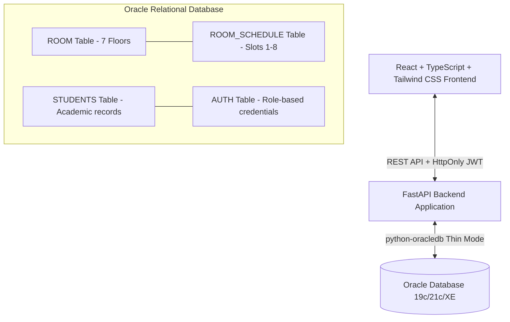

# VITSpace — PRP Classroom Availability Management System

A production-ready full-stack web application designed for **PRP Block (Periyar Building) at VIT Vellore**, providing real-time classroom & laboratory availability tracking, weekly timetable management, and role-based student/admin access powered by an **Oracle Database** and a high-performance **FastAPI** backend with a **React + TypeScript + Tailwind CSS** frontend.

---

## 🏛️ System Architecture



### Relational Schema

| Table | Primary Key | Description & Integrity Constraints |
|---|---|---|
| `ROOM` | `RoomID` (Sequence) | PRP Block rooms with `Floor` (1–7), `RoomType` ('Classroom' \| 'Lab'), and `Capacity` (> 0). |
| `ROOM_SCHEDULE` | `ScheduleID` (Sequence) | Mappings for `RoomID` on `DayOfWeek` (MON–SAT) and `SlotNumber` (1–8) with start/end timestamps. Unique constraint on `(RoomID, DayOfWeek, SlotNumber)`. |
| `STUDENTS` | `RegNo` | Academic record: `Name`, `Mail`, `Dept`. |
| `AUTH` | `UserID` (Sequence) | Isolated authentication: `Username` (unique), `PasswordHash` (bcrypt), `Role` ('student' \| 'admin'), and optional `RegNo` foreign key. |

---

## ✨ Features

### 🎓 Student Experience
- **Live Classroom Finder**: Dynamic query engine filtering by **Day of Week** (MON–SAT), **Slot Number** (Slots 1–8 with standardized timings), **Floor** (1–7), and **Room Type** (Classroom or Lab).
- **One-Click "Find Free Room Right Now"**: Auto-detects current weekday and active period to display vacant study spaces instantly.
- **Weekly Room Timetable Matrix**: Visual schedule modal displaying occupied vs. free periods across all 6 days.
- **PRP Directory**: Browse all 7 floors of lecture halls and labs.
- **Profile Hub**: Academic details linked to student identity.

### 🛡️ Administrator Console
- **Analytics & Overview**: Floor-by-floor room and capacity distribution, total active schedules, and student statistics.
- **Room Management (CRUD)**: Create, update, and delete rooms with strict validation matching Oracle check constraints.
- **Schedule Management (CRUD)**: Assign timetable slots with automated conflict detection.
- **Student Directory**: Browse, search, add, and manage student accounts and departments.
- **Demo Switcher**: Built-in test credential autofill for smooth presentations and evaluations.

---

## 🚀 Getting Started

### Prerequisites
- **Python 3.10+**
- **Node.js 18+** & npm
- **Oracle Database** (XE, 19c, or 21c) accessible via TCP port (e.g. `localhost:1521/XEPDB1`)

---

### 1. Backend Configuration & Setup

1. Open a terminal in the `backend/` directory:
   ```bash
   cd backend
   ```
2. Create your `.env` file (copy from `.env.example`):
   ```bash
   cp .env.example .env
   ```
3. Configure your Oracle connection details in `.env`:
   ```env
   ORACLE_USER=your_db_username
   ORACLE_PASSWORD=your_db_password
   ORACLE_DSN=localhost:1521/XEPDB1
   AUTH_SECRET=your-random-64-char-secret-key-here
   ADMIN_USERNAME=admin
   ADMIN_PASSWORD=admin123
   FRONTEND_ORIGIN=http://localhost:5173
   ```
4. Install backend dependencies:
   ```bash
   pip install -r requirements.txt
   ```
5. Initialize the `AUTH` table and seed the initial admin account:
   ```bash
   python setup_admin.py
   ```
   *(Optionally add `--register-students` to create matching login credentials for all rows in your `STUDENTS` table)*
6. Start the FastAPI application server:
   ```bash
   uvicorn app.main:app --reload --port 8000
   ```
   Interactive Swagger docs will be live at `http://localhost:8000/docs`.

---

### 2. Frontend Setup

1. Open another terminal in the `frontend/` directory:
   ```bash
   cd frontend
   ```
2. Install npm dependencies:
   ```bash
   npm install
   ```
3. Start the Vite development server:
   ```bash
   npm run dev
   ```
4. Open [http://localhost:5173](http://localhost:5173) in your browser.

---

## 🔑 Default Credentials

| Role | Username / RegNo | Password | Access Level |
|---|---|---|---|
| **Administrator** | `admin` | `admin123` | Full CRUD on Rooms, Schedules, Students, Dashboard |
| **Demo Student** | `21BCE0001` | `student123` | Availability Search, Room Directory, Timetables, Profile |

*(You can also click the quick-fill buttons on the login card to instantly populate test credentials)*

---

## 📡 API Endpoints Summary

| Method | Endpoint | Access | Purpose |
|---|---|---|---|
| `POST` | `/api/auth/login` | Public | Authenticate user, issue HttpOnly JWT cookie |
| `POST` | `/api/auth/logout` | Authenticated | Invalidate authentication cookie |
| `GET` | `/api/auth/me` | Authenticated | Retrieve current session details and profile |
| `GET` | `/api/dashboard/admin` | Admin | Comprehensive PRP infrastructure metrics |
| `GET` | `/api/dashboard/student` | Authenticated | Student dashboard statistics |
| `GET` | `/api/dashboard/floors` | Authenticated | Summary breakdown for floors 1 through 7 |
| `GET` | `/api/availability` | Authenticated | Real-time room availability computed by Oracle SQL |
| `GET` | `/api/rooms` | Authenticated | Filter rooms by floor, type, capacity |
| `POST` | `/api/rooms` | Admin | Create a new room with Oracle constraint validation |
| `PUT` | `/api/rooms/{id}` | Admin | Update room parameters |
| `DELETE`| `/api/rooms/{id}` | Admin | Delete room (checks foreign key integrity) |
| `GET` | `/api/schedules` | Authenticated | List schedule allocations with filters |
| `POST` | `/api/schedules` | Admin | Assign new slot to a room |
| `DELETE`| `/api/schedules/{id}` | Admin | Delete a scheduled slot |
| `GET` | `/api/students` | Admin | Search and list student records |
| `POST` | `/api/students` | Admin | Register new student record |
| `GET` | `/api/health` | Public | Database connectivity check |

---

## 🏛️ PRP Standard Academic Slots

- **Slot 1**: 08:00 – 08:50
- **Slot 2**: 09:00 – 09:50
- **Slot 3**: 10:00 – 10:50
- **Slot 4**: 11:00 – 11:50
- **Slot 5**: 12:00 – 12:50
- **Slot 6**: 14:00 – 14:50
- **Slot 7**: 15:00 – 15:50
- **Slot 8**: 16:00 – 16:50
